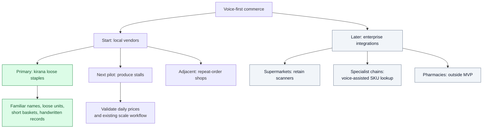
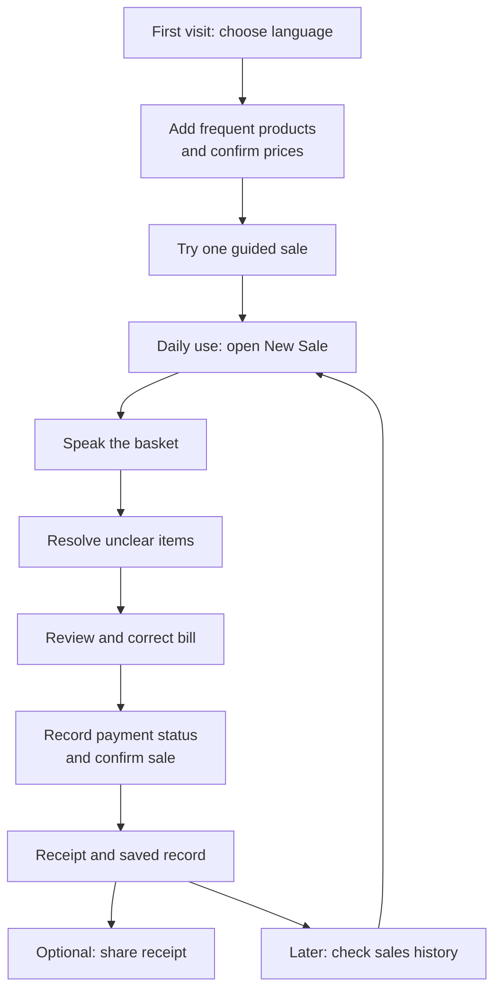
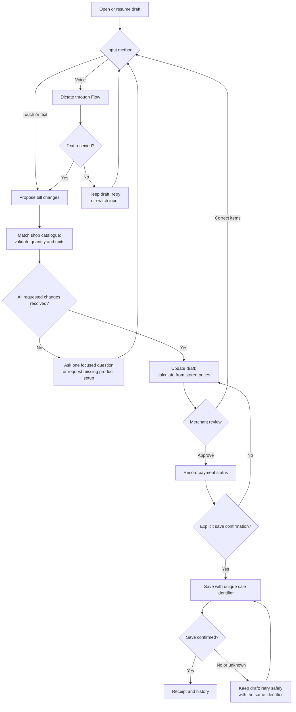
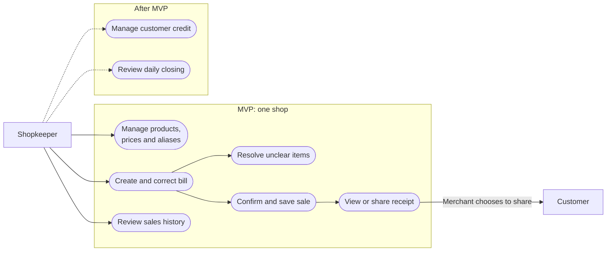
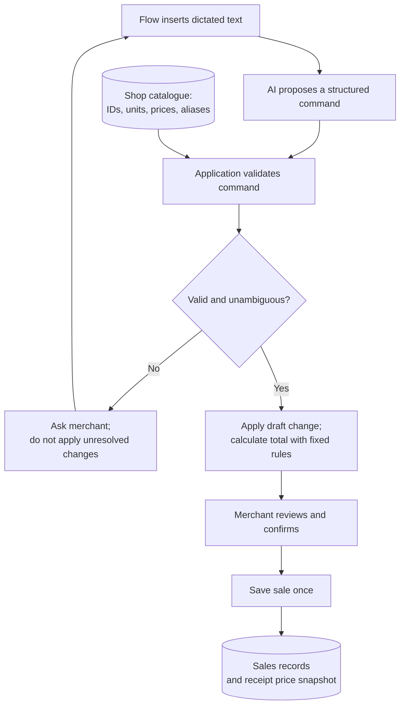
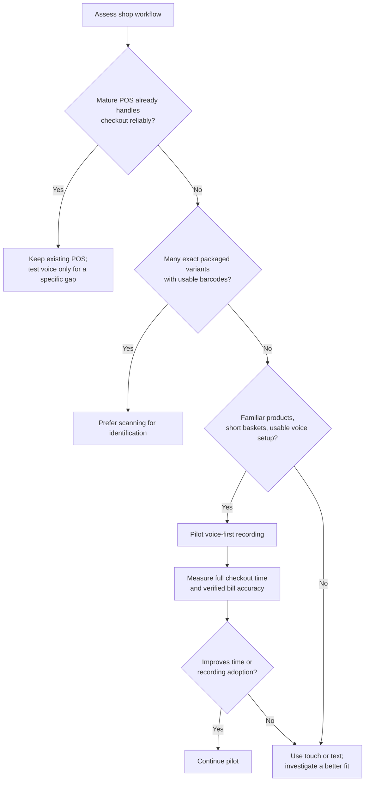
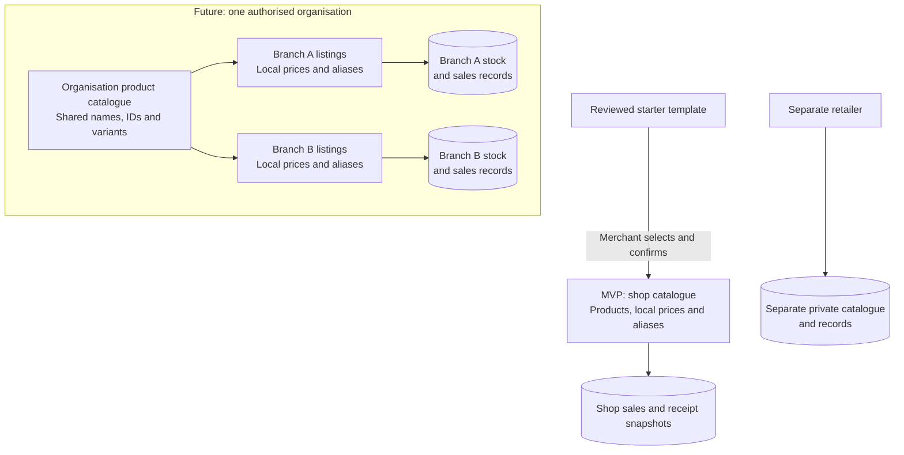
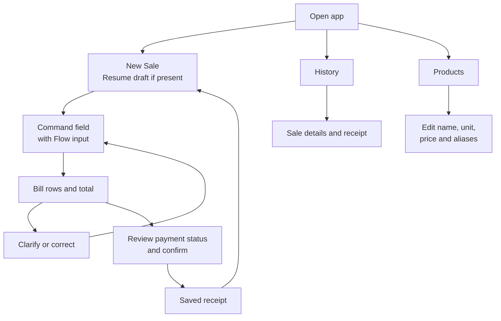

# BolBill — voice-first billing for neighbourhood shops

Project master document · Working name · Prepared 12 November 2026

## 1. Decision and positioning

Build a phone-first sales ledger for small, owner-operated shops selling loose goods and familiar repeat items. The merchant speaks a short basket, checks a clear bill, and confirms the sale. The app creates a receipt and a usable digital record.

**Core promise:** “Say the sale. Check the bill. Keep the record.”

The strongest starting market is a neighbourhood kirana selling loose rice, pulses, sugar, and other frequently requested goods. Its merchant already knows the products and prices. Voice should reduce the work needed to record those sales.

Do not base the pitch on beating supermarket scanners. Base it on making digital records practical where merchants currently use handwritten slips, mental arithmetic, or no records.

This is a product hypothesis, not a validated claim. Speed, accuracy, ease of adoption, and willingness to pay require field tests.

## 2. Information-rich context for an LLM

We are designing a voice-first billing and sales-recording app for Indian small businesses. Merchants use an existing compatible smartphone to speak product names, quantities, units, corrections, and payment status in natural Hindi, English, or mixed speech. The app resolves those instructions against the shop’s own catalogue, asks about ambiguous items, calculates prices through deterministic rules, and shows a bill for explicit confirmation. Confirmed sales generate digital receipts and searchable records.

The first target is an owner-operated kirana selling loose goods and a small set of repeat products. Initial scope is one shop, one merchant, a curated catalogue, and Hindi-English input. Voice is the main input; touch and text remain available when speech fails. We will test complete checkout time against handwriting and manual phone entry. We will compare scanning only where the same goods have usable barcodes.

Catalogue templates can help shops start, but prices, variants, stock, and aliases belong to each merchant. A later organisation catalogue can share product definitions across branches while preserving branch-specific prices and stock. Pharmacies, supermarkets, and large specialist retailers are outside the MVP.

The product aims to lower hardware and learning barriers, not replace every POS or ERP capability. It must never invent prices, silently choose uncertain variants, infer successful payment from a QR code, or finalize a sale without confirmation. Initial differentiation is shop-specific language, fast correction, and reliable records. A later customer-credit ledger can add daily value.

## 3. Hackathon fit and current requirements

The suitable theme is **Small business**. The public brief asks for voice-first tools for India, built through voice with Wispr Flow. Its FAQ permits other editors and AI tools. Flow is therefore part of the building workflow; it does not replace an AI coding assistant. [Official theme and FAQ](https://hackos.scaler.com/wispr/)

As of 12 November 2026, Round 1’s Idea activity is open. Prompt opens 13 November; Impact opens 20 November; Round 1 closes 26 November. Round 2 reveals one common problem statement on 27 November, with builds due 29 November. Treat this concept as the current idea, subject to that brief. [Official schedule](https://hackos.scaler.com/wispr/)

Each round’s detailed submission requirements appear separately. The public page does not establish a strict no-typing rule, an exclusive AI tool, or a mandatory embedded Flow API. Check the logged-in activity before submitting. Team membership locks after the first submission, including an idea. Finalise teammates first. [Official submission and team FAQ](https://hackos.scaler.com/wispr/)

**Practical interpretation:** dictate requirements, prompts, and revisions through Flow into your chosen AI tool. Keep a short recording of that workflow. Do not assume that finishing this concept now satisfies Round 2.

### Flow inside the proposed product

Use Flow’s existing text insertion workflow for the prototype: focus the app’s command field, dictate through Flow, then process the inserted text. Flow documents a desktop shortcut, iPhone keyboard, and Android bubble. This does not require assuming an embedded SDK exists. [How Flow works](https://docs.wisprflow.ai/articles/2772472373-what-is-flow)

Prototype the actual device interaction first. The app’s microphone design must not imply it directly controls Flow unless that integration is verified. On mobile, use a normal text field compatible with Flow’s input controls.

Flow transcription requires internet access. Its current Android requirements include Android 13 or later; 6 GB RAM is recommended. These constraints matter for low-cost phones. Say “no dedicated billing hardware on a compatible phone,” not “works on every phone.” [Connectivity limits](https://docs.wisprflow.ai/articles/4048537120-what-to-expect-from-flow-accuracy-and-known-limitations), [Android requirements](https://docs.wisprflow.ai/articles/6344532666-android-system-requirements)

## 4. Where this will earn repeated use

### Vertical map

Priority reflects the proposed pilot strategy, not measured market demand.

| Setting | Why voice may help | Decision |
|---|---|---|
| Kirana with loose grains, pulses, sugar, and repeat staples | Product names are familiar; goods may have no item barcode; records often require a separate step | Primary pilot |
| Small produce stall with fixed daily prices | Short baskets and loose units suit speech | Second pilot; test changing prices and weighing workflow |
| Small shop with repeat customer orders | Shop-specific names and saved baskets may reduce entry | Later adjacent use |
| Packaged-goods supermarket | Scanning already identifies exact variants efficiently | Retain scanning; no replacement claim |
| Pharmacy | Similar names, strengths, pack sizes, batches, and expiry create costly errors | Exclude from MVP |
| Decathlon-like chain | Exact SKU variants, central systems, returns, and branch controls dominate | Future integration opportunity only |

Voice cannot weigh produce. Merchants still need their existing scale where goods require weighing. “No extra hardware” means no required new scanner, computer, or receipt printer for this app.

### Two customer groups, different value propositions

**Local vendors:** offer a low-friction first digital record, usable from an existing phone. Receipts, sales history, and later credit tracking provide value beyond entering a bill.

**Enterprises:** potentially offer a voice input layer for existing software, such as assisted orders or catalogue search. Replacing enterprise software would require much broader capabilities and migration work. It is a separate product phase.

## 5. Simple end-to-end workflow

### Merchant journey

This journey shows the proposed experience. It does not assign untested satisfaction scores.

### Billing workflow and recovery

### A. Set up the shop once

1. Choose language and enter shop details.
2. Add the shop’s most frequently sold products through voice or a simple import.
3. Confirm each product’s name, sale unit, price, and relevant variant.
4. Add local aliases, such as “chini” for the merchant’s sugar product.
5. Complete one guided sample sale.

Aim for a useful first bill quickly, rather than requiring a complete inventory first. “Minimal onboarding” is a credible goal; “no training or setup” is not yet proven.

### B. Create a sale

1. Open New Sale and focus the command field.
2. Dictate: “Do kilo chawal, aadha kilo chini, aur ek kilo masoor dal.”
3. The app extracts requested products, quantities, and units.
4. It matches only against this shop’s active catalogue.
5. Clear matches become draft bill rows with visible prices.
6. Unclear matches produce a short question: “Which rice: regular or basmati?”
7. Correct the draft: “Chini ek kilo kar do.”
8. Review the total. Record cash, UPI reported by merchant, or unpaid status.
9. Explicitly confirm and save.
10. Show a receipt and offer the phone’s share action.

### C. After the sale

The merchant can reopen the receipt and view today’s recorded sales. The system distinguishes draft, saved, and voided bills. Retrying a save must not create a second sale.

No message goes to a customer automatically. Sharing requires merchant action. Customer identity is optional for an ordinary paid sale.

## 6. MVP: the smallest complete product

### Use-case map

Customers receive receipts through merchant-initiated sharing. They do not need an app account for an ordinary paid sale.

| Capability | Acceptance condition |
|---|---|
| One shop and curated catalogue | Merchant can create and edit products, units, prices, and aliases |
| Hindi-English dictated commands | Flow text reaches the app and creates a structured draft |
| Multiple items in one command | One short utterance produces several correct rows |
| Quantity and unit handling | Half kilo and 500 grams resolve consistently for a compatible product |
| Clarification | Missing products, units, or variants never become silent guesses |
| Corrections | Change quantity, remove a named item, and undo the last draft change |
| Safe totals | Stored prices and deterministic decimal or minor-unit arithmetic determine the total |
| Explicit finalization | Only merchant confirmation creates a saved sale |
| Receipt and history | Merchant can reopen a saved receipt and see daily recorded sales |
| Recovery | Failed saves preserve the draft; retries do not duplicate bills |
| Touch/text fallback | Merchant can complete the bill if voice fails |

Use one working language pair and roughly 30–50 representative products for the demo. These are scope choices, not market limits.

Do not include automated inventory depletion unless opening stock, restocking, returns, and unit conversions are implemented reliably. A sales ledger is useful without pretending to know exact stock.

## 7. Accuracy: what must be trustworthy

Barcode scanning typically supplies a product identifier. Voice must resolve a description into that identifier and interpret quantity and intent. A fluent transcript alone does not establish a correct bill.

### Trust boundaries

An LLM may propose structured commands. Application rules must verify product IDs, allowed units, quantities, and prices before applying them. Treat spoken text as input, never unrestricted instructions to the database.

Required rules:

- Never invent an item, price, tax rate, or discount.
- Ask when several variants fit; do not treat model confidence as calibrated certainty.
- Reject negative quantities and incompatible units; confirm unusually large quantities.
- Distinguish “add two” from “make it two.” Resolve the referenced item before editing.
- Make a saved bill retain the price used at sale time, even after catalogue prices change.
- Allow undo on drafts. Preserve a traceable void or correction for saved transactions.
- Separate shop data and restrict access to each merchant’s records.
- Store only necessary customer data. Do not add app-side audio storage by default; review Flow’s own privacy settings separately.

Example ambiguity: “Surf ek” needs a pack size if the shop sells several. “Dal do” can be linguistically ambiguous. Ask a concrete question rather than selecting the most popular item.

## 8. Why use this instead of scanning or established software?

**The strongest reason is accessible recordkeeping for an underserved workflow. Speed is a hypothesis.**

### Choose the input that fits the sale

| Situation | Better starting choice | Reason |
|---|---|---|
| Loose items, familiar names, short basket | Test voice | Merchant can describe several lines without finding products in menus |
| Many packaged variants with readable barcodes | Scanner | Exact identification avoids speaking long variant names |
| Noise, speech difficulty, or failed transcription | Touch/text or scanning | Merchant needs a dependable fallback |
| Large checkout operation with mature POS | Existing POS | Replacing integrated operations adds substantial risk and cost |
| Small shop without digital records | Phone-first voice ledger | Lower setup burden may make recording practical |

Existing billing products may also offer mobile apps, subscriptions, or free tiers. A subscription alone is not differentiation. Do not claim competitors all require costly hardware or large upfront fees without a current comparison.

Measure total ownership cost: app subscription, any required Flow plan, internet, setup, support, and merchant time. No pricing or savings percentage is validated yet.

The pitch should be: **“We remove the work of turning a spoken sale into a digital record.”** Avoid “more reliable than barcodes” until comparative evidence exists.

## 9. Differentiation and additional tools

### Build into the core

**Shop-specific vocabulary:** save confirmed aliases against exact products. Ask before learning ambiguous names. Corrections improve future matching within that shop.

**Fast correction:** merchants should be able to say “remove the sugar” or “make rice half a kilo” without rebuilding the basket.

**Visible uncertainty:** show the exact product, unit, quantity, and price. Ask only the unresolved question rather than repeating the whole bill.

### First feature after the MVP: customer credit ledger

Many repeat-customer shops may find unpaid balances more useful than another dashboard. Validate this through interviews before building.

Example: “Ramesh ke naam udhaar.” Select or confirm the correct customer, then attach the saved sale. Later: “Ramesh ne sau rupaye diye.” Show the proposed balance change before saving.

Record partial payments and preserve an audit trail. Never merge customers by name alone. Do not send reminders without merchant approval and an appropriate contact/consent process.

### Later tools, in priority order

1. **Daily closing:** recorded sales split by cash, merchant-reported UPI, and credit. Keep sales, cash collected, and repayments distinct.
2. **Repeat baskets:** reopen a previous basket, apply current prices, and confirm changes.
3. **Restock notes:** “Add sugar to tomorrow’s purchase list,” without claiming exact stock prediction.
4. **Simple export:** sales and credit records that merchants can take to an accountant or another system.
5. **Catalogue import:** merchant-reviewed spreadsheet import; invoice-photo extraction only after proving onboarding is the bottleneck.

Avoid adding forecasting, supplier marketplaces, loyalty schemes, automatic lending, and enterprise analytics to the hackathon build.

## 10. Catalogue strategy and branch sharing

### Shared definitions, separate shop records

The MVP uses the shop layer. Organisation and branch sharing are future scope.

Separate reusable product definitions from each shop’s commercial data:

- **Product definition:** stable ID, name, brand, size or variant, base unit, optional barcode.
- **Shop listing:** enabled products, local name, sale unit, selling price, and confirmed aliases.
- **Organisation catalogue, later:** centrally approved definitions shared with authorised branches.
- **Branch records, later:** local prices, availability, stock, and transactions.

A general product library can suggest names and variants. It cannot know a merchant’s selling price or stock. Start with a small manually reviewed template. Do not assume an exhaustive, accurate, reusable national catalogue is freely available.

Branch sharing should exist within an organisation’s permissions. One retailer’s private catalogue must not become another retailer’s data. Evaluate catalogue licensing before importing outside datasets.

## 11. Mobile experience

### Screen map

Use three main destinations: **New Sale, History, Products**. The home screen opens to a new sale, with a visible draft if one exists.

The sale screen contains the bill, total, command field, and a clear next action. Use large type and touch targets, readable contrast, and short language. Show product names alongside quantities and units. Do not rely on colour alone for unresolved items.

Distinguish listening, transcription processing, command review, and saved status. A spinner must not look like a completed sale. Keep correction controls near bill rows. Use a distinct final confirmation step so a mistaken command cannot silently close a bill.

Desktop can reuse the same flow with more space. Do not build a separate enterprise dashboard for the MVP.

## 12. Architecture and operational boundaries

Use one responsive web app, one backend, and one database. Flow inserts speech as text into the command field. The backend converts text into constrained proposed actions, validates them against the shop catalogue, and returns a draft change. Saved sales use a transaction and a unique save identifier.

Do not begin with microservices, custom speech-model training, a vector database, or several AI agents. Catalogue aliases and bounded matching should be tested first.

Weak connectivity is a real constraint. Preserve a draft locally where practical, display save status, and provide retry. Offline voice is outside the initial Flow-based design. Offline final sales need a deliberate sync design; do not imply a local draft is backed up.

A receipt is a sales record. Do not market the MVP as a compliance-complete tax invoicing system. Fiscal invoicing requirements need a separate, current review before production use.

Recording “UPI” is merchant input, not payment verification. Displaying a payment QR code is not proof of receipt. Automated reconciliation requires a verified payment integration.

## 13. Proving the idea

### Before building broadly

Interview five merchants in one shop category. Observe their real sales process with permission. Ask how they identify items, set prices, track credit, correct mistakes, and handle network failure. Test their actual phones for Flow compatibility.

The decisive question is: **Does speaking make the merchant more likely to record a sale accurately?**

### Benchmark

Use matched baskets with the same merchant and products. Rotate method order to reduce learning effects. Compare handwriting, manual app entry, and voice. Include barcode checkout only for items that support it.

Measure from starting entry to a verified, saved bill—not speaking time alone. Track median and slow-case time, correction count, wrong product variants, quantity/unit errors, final amount errors, failed attempts, and duplicate saves.

Include at least 30 varied baskets, repeated by several merchants if feasible: loose quantities, near-identical names, code-switching, correction phrases, background noise, and network interruptions. This is a pilot, not proof of production-grade accuracy.

Proposed go/no-go gates:

- Every tested saved bill matches the merchant-approved product, quantity, price, and total.
- Unresolved items cannot be finalized.
- Save retries create no duplicate transactions.
- Merchants can complete a simple bill after one guided example.
- Voice improves complete-task time or recording adoption in the chosen setting.

Zero observed errors in a small test does not establish universal accuracy. Publish actual results and failures. If packaged-goods scanning wins, retain that result and narrow the product’s use case.

## 14. Hackathon demonstration

Show one shop and one complete story:

1. A merchant opens a phone app with a small, verified catalogue.
2. One Hindi-English utterance creates a three-item basket.
3. A vague item triggers a focused clarification.
4. A spoken correction updates the right row.
5. Merchant checks and confirms the bill.
6. Receipt and recorded daily sales update.
7. A repeated save attempt does not duplicate the sale.

Show actual Flow interaction and measured checkout time. Explain the boundary: this demo serves a loose-goods kirana, while barcode-heavy retailers keep their scanners.

## 15. Submission-ready idea

BolBill is a voice-first billing and sales ledger for neighbourhood kirana shops that still rely on handwritten slips or mental records. A merchant uses a compatible smartphone to speak a basket in Hindi, English, or mixed speech. The app matches items to the shop’s catalogue, clarifies uncertain products, calculates the total, and saves a receipt after confirmation.

We focus first on loose staples and familiar repeat items, where barcodes offer limited help. Our differentiators are shop-specific vocabulary, quick spoken corrections, and a digital record created as part of the sale. No dedicated scanner, computer, or printer is required. Touch and text remain available when voice fails.

The MVP covers one shop, a curated catalogue, bill creation, correction, receipts, and sales history. Customer credit tracking is the first proposed extension. We will evaluate success through verified bill accuracy and full checkout time against merchants’ current methods, rather than claiming voice always beats scanning.

## 16. Open decisions

1. Which nearby merchant can provide real workflow feedback and a pilot catalogue?
2. Is Hindi-English the correct language pair for that merchant?
3. Does their phone meet Flow’s requirements, and is counter connectivity adequate?
4. Are teammates finalised before the first submission locks the team?
5. What exact fields, limits, and evidence does the logged-in Idea activity request?

Default scope until answered: one kirana, loose staples, Hindi-English, compatible Android phone, one merchant, sales ledger only. Revisit scope when Round 2’s common brief appears.
