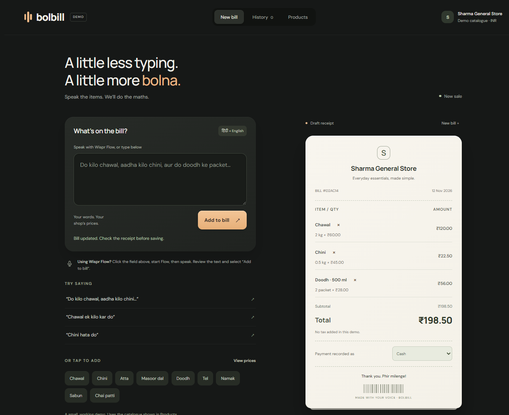
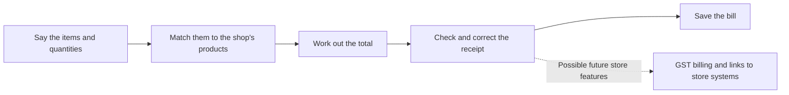

# BillBoley

BillBoley is a billing demo for Indian shops. The idea is simple: say what a customer is buying, check the bill, and save it.

## The problem

Shopkeepers make sales all day, but entering every product and quantity into a billing screen takes time. During a rush, that means slower queues and less time for customers.

There is a related challenge for medium and large stores that use computers and give customers GST bills. Billing systems, scanners, and staff training can all add to the cost of running multiple checkout counters.

## Who it is for

- **Kirana and neighborhood shops:** Owners may deal with this at every sale, especially when several customers are waiting.
- **Medium-to-large stores:** Retailers with computer-based checkout may want simpler software, faster staff onboarding, and lower equipment costs across their counters.

## How BillBoley works

A shopkeeper can say, “Do kilo chawal, aadha kilo chini, aur do doodh ke packet.” BillBoley matches the words to products, works out the total, and shows a receipt to check before saving.

Speaking fits the way shopkeepers and customers already talk about a sale. It can be quicker than filling out several fields and leaves the shopkeeper's hands free to handle goods. The receipt stays on screen so mistakes can be corrected before the bill is saved.

## For larger stores

Over time, BillBoley could give larger retailers a lower-cost billing subscription and a simpler way to train new staff. Speaking product names and quantities could reduce the need to buy a scanner for every counter. Scanners may still make sense for stores that need to identify products by barcode, so the right setup will depend on the shop.

GST billing, connections to existing store systems, and tools for managing multiple locations would need to be built for that version. They are not part of this demo.

## Try the demo

Open `dist/index.html` in a browser. You can type an order or use Wispr Flow to dictate into the order box, then choose **Add to bill**. Wispr Flow runs separately from BillBoley; typing and the product buttons work without it.

Try saying or typing:

- `Do kilo chawal, aadha kilo chini, aur do doodh ke packet`
- `Chawal ek kilo kar do`
- `Chini hata do`
- `250 ml tel`

The demo uses an example product list and sample prices. It understands a limited set of product names, quantities, and edits; it is not a general speech assistant. Check the receipt and confirm it before saving. Bills and draft recovery stay in the browser on that device. The demo does not record audio, verify payments, track stock, or create legal GST invoices.
